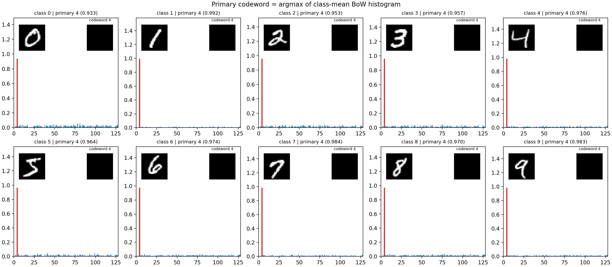
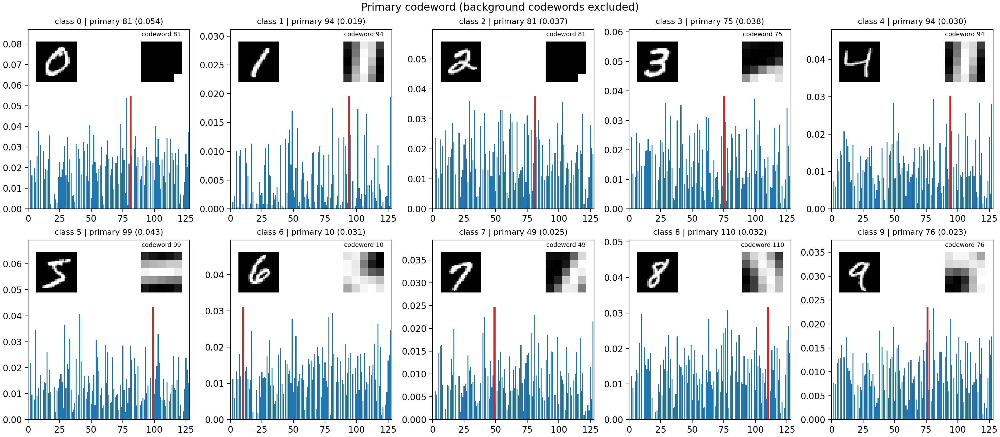

# Bag-of-Words

Test BoW algorithm

MNIST 데이터셋에 Bag-of-Visual-Words(BoW) 이미지 분류 파이프라인을 적용하고, 각 숫자 클래스의 **primary codeword**를 찾아 시각화하는 과제.

## 파이프라인

| 단계 | 설명 | 함수 |
|---|---|---|
| 1. 패치 추출 | 28x28 이미지에서 5x5 패치를 추출. 각 패치는 평균 0, 표준편차 1로 정규화 | `extract_dense_patches` |
| 2. 코드북 생성 | 학습 패치 중 무작위 20만 개를 뽑아 `MiniBatchKMeans`(K=128)로 군집화. 클러스터 중심이 코드워드 | `build_codebook` |
| 3. 이미지 표현 | 모든 패치를 가장 가까운 코드워드에 배정하고 개수를 세어 K차원 히스토그램을 만든 뒤 L2 정규화 | `images_to_bow_hist` |
| 4. 분류 | BoW 히스토그램으로 로지스틱 회귀 학습 | `train_and_eval` |

## 클래스별 Primary Codeword

각 클래스(0~9)에 속한 학습 이미지들의 BoW 히스토그램을 평균내고, 이 평균 히스토그램에서 값이 가장 큰 코드워드를 그 클래스의 **primary codeword**로 정의함.

**배경 코드워드 제외.** 단순 argmax를 쓰면 10개 클래스 모두 같은 코드워드(index 4, 거의 균일한 검은 패치)가 선택되는 문제가 발생. 따라서 **중심 벡터의 노름이 0.5 미만인 코드워드를 배경으로 판정**해 argmax 후보에서 제외함.

| 클래스 | 0 | 1 | 2 | 3 | 4 | 5 | 6 | 7 | 8 | 9 |
|---|---|---|---|---|---|---|---|---|---|---|
| Primary codeword | 81 | 94 | 81 | 75 | 94 | 99 | 10 | 49 | 110 | 76 |

